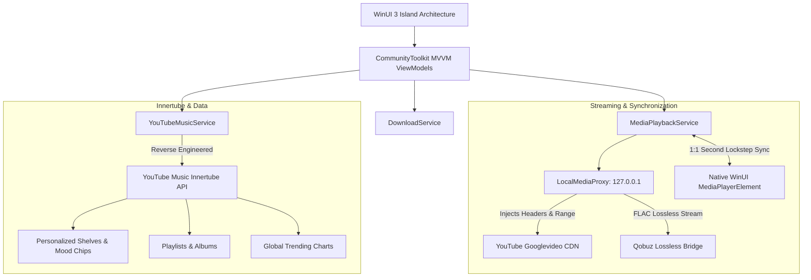

# FluentMusic 🎵
> **Where Apple Music Elegance meets Windows 11 Fluent Design & Studio-Quality Lossless Fidelity.**

[](https://github.com/EchoMusicApp/Echo-Music/actions)
[](https://github.com)
[](https://microsoft.com)
[](https://dotnet.microsoft.com)
[](https://flac.sourceforge.net/)
[](LICENSE)

---

## ✨ Features & Architecture

FluentMusic is an ultra-modern desktop YouTube Music client engineered from the ground up for Windows 11, fusing the design language of Apple Music / macOS with Windows 11 Mica Alt dual-island glass aesthetics.

### 🌟 Highlights

- **🎧 True Studio-Grade Lossless FLAC (1411 kbps):** Prioritizes studio-master FLAC streaming and downloads via high-fidelity Qobuz bridges, with fallback to high-bitrate AAC.
- **🎬 Tight 1:1 Second Video-Audio Lockstep Sync:** Stream official 1080p/720p YouTube Music Videos through native WinUI `MediaPlayerElement` while perfectly synchronizing playback with studio FLAC audio. Automatic buffering compensation pauses and resumes audio in lockstep with video buffers.
- **🛡️ Local Media Loopback Proxy:** High-performance loopback HTTP proxy running on `127.0.0.1` injecting browser User-Agent, Referer, and HTTP Range headers, eliminating YouTube CDN HTTP 403 Forbidden errors permanently.
- **🌌 Dynamic Live Ambient Mesh Gradient:** Rich dual-radial gradient mesh backdrop in the Now Playing overlay dynamically reflecting the dominant colors of the active album art.
- **👤 Google Account & YouTube Music Sync:** Seamlessly authenticate with your Google / YouTube Music account to synchronize your real personalized recommendations, mixes, playlists, and liked songs with avatar display.
- **📋 Complete Queue Management System:** Comprehensive queue controls on every track across Home, Explore, and Library:
  - ▶ **Play Now**
  - ⏭ **Play Next**
  - ➕ **Add to Queue**
  - ⬇ **Download FLAC / Lossless**
  - Instant Up Next Queue Flyout with reorder, remove, and clear.
- **💿 Universal Format Offline Player:** Native playback and offline management for all audio formats:
  - **Lossless:** FLAC, ALAC, WAV
  - **High-Res:** AAC, M4A
  - **Compressed:** OPUS, OGG, MP3, WMA
- **🎤 Karaoke Synchronized Lyrics:** Frosted acrylic lyrics drawer with real-time timed lyrics matching playback millisecond by millisecond.
- **💊 Dynamic Stream Fidelity Badges:** Precise bitrate badges reflecting exact audio source:
  - `Hi-Res Lossless` (1411 kbps · FLAC · Lossless)
  - `Hi-Res` (256 kbps · AAC · Hi-Res)
  - `Basic` (320 kbps · MP3 / OPUS · Basic)
- **🎛️ Segmented Modular Settings:** 5 distinct settings tabs for Appearance, Audio Fidelity, Account Sync, Downloads, and Version telemetry.

---

## 🏛️ System Architecture



---

## ⌨️ Keyboard Shortcuts

| Shortcut | Action |
|:---|:---|
| <kbd>Space</kbd> | Play / Pause playback |
| <kbd>Ctrl</kbd> + <kbd>→</kbd> | Next track in queue |
| <kbd>Ctrl</kbd> + <kbd>←</kbd> | Previous track |
| <kbd>Ctrl</kbd> + <kbd>↑</kbd> | Volume up (+5%) |
| <kbd>Ctrl</kbd> + <kbd>↓</kbd> | Volume down (-5%) |
| <kbd>Ctrl</kbd> + <kbd>E</kbd> / <kbd>Ctrl</kbd> + <kbd>F</kbd> | Focus global search bar |
| <kbd>Ctrl</kbd> + <kbd>L</kbd> | Toggle lyrics drawer |
| <kbd>Ctrl</kbd> + <kbd>N</kbd> | Toggle full-stage Now Playing overlay |

---

## 🚀 Building & Installation

### Prerequisites
- Windows 11 (Version 22H2 or higher recommended)
- [.NET 8.0 SDK](https://dotnet.microsoft.com/download/dotnet/8.0)
- Windows App SDK 1.5+
- Visual Studio 2022 with Windows App Development workload

### Quick Build
To restore dependencies and build the solution locally:
```powershell
# Restore NuGet dependencies
dotnet restore YTMusicClient.sln /p:Platform=x64

# Build project in Release mode
dotnet build YTMusicClient.sln -c Release /p:Platform=x64
```

### Packaging MSIX for Sideloading
To generate a self-signed sideloadable `.msix` package:
```powershell
./build-msix.ps1 -Configuration Release
```
The output `.msix` bundle will be generated under `src/YTMusicClient/AppPackages/`.

---

## 📄 License
Licensed under the [MIT License](LICENSE).
